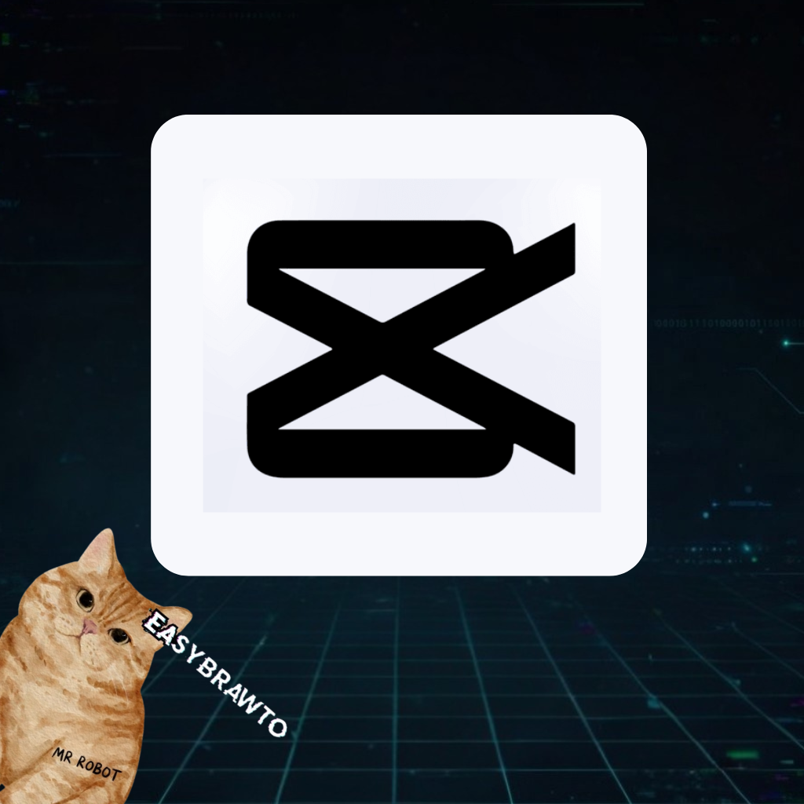

<div align="center">



# CapCut Auto Editor

**Automate your CapCut Desktop post-production — bulk apply zooms, effects, and transitions instantly**

*A personal project to speed up repetitive video editing — contributions welcome!*

[](https://github.com/Saimonsanbr/capcut-auto-editor/releases/latest)
[](LICENSE)
[](https://www.electronjs.org/)

<br/>

[**⬇ Download for macOS**](https://github.com/Saimonsanbr/capcut-auto-editor/releases/latest/download/CapCut-Auto-Editor-mac.dmg)
&nbsp;&nbsp;
[**⬇ Download for Windows**](https://github.com/Saimonsanbr/capcut-auto-editor/releases/latest/download/CapCut.Auto.Editor.Windows.exe
)

<br/>

</div>

---

## What is this?

CapCut Auto Editor is a desktop application that lets you batch process multiple CapCut projects in seconds. It completely automates the tedious post-production steps.

Instead of opening every project manually to apply zooms to photos and toss effects onto clips, you simply select your draft projects in this app, click **Edição Mágica**, and it manipulates the CapCut internal JSON timelines directly.

No manual clicking. No rendering bottleneck. Just instant timeline routing.

---

## Installation

### macOS

1. Download `CapCut-Auto-Editor-mac.dmg` from the links above (or the [latest release](https://github.com/Saimonsanbr/capcut-auto-editor/releases/latest)).
2. Open the `.dmg` and drag the app to `Applications`.
3. The app is **not notarized by Apple**, so on first launch macOS may block it ("cannot be opened because the developer cannot be verified"). To allow it, run once in the Terminal:

```bash
xattr -cr "/Applications/CapCut Auto Editor.app"
```

Then open the app normally. (Alternative without Terminal: right-click the app → **Open** → **Open** again in the warning dialog.)

### Windows

1. Download `CapCut.Auto.Editor.Windows.exe` from the links above (or the [latest release](https://github.com/Saimonsanbr/capcut-auto-editor/releases/latest)).
2. Run the installer. Windows SmartScreen may warn that the app is from an unknown publisher (the app is unsigned) — click **More info** → **Run anyway**.
3. Open **CapCut Auto Editor** from the Start menu.

> **Tip:** close CapCut Desktop before running the magic edit, and reopen it afterwards so it reloads the modified timelines.

---

## Features

### Operation modes

- **💥 Random Mode (Fully Automated):** the app ignores your existing timeline timing. It reads your main audio track length, then randomly slices and duplicates your media pool to fill the duration. Ideal for quick generative montages.
- **🎯 Controlled Mode (Manual Cuts):** you do the raw cuts in CapCut in rhythm with your music. The app respects your start times and durations, and automates the heavy post-production: transitions, zooms/pans, duplicated blurred backgrounds, effects, fade in/out.

### Photos

- **Small photos** (shortest side under 500px, any aspect): always get the dual treatment — enlarged background (min 2.0x zoom) + sharp foreground with animated zoom — so they never look blurry or pixelated.
- **Large off-16:9 photos**: randomly get either the dual treatment or the **pan move** — big fixed zoom (3.4x–4.0x on vertical, ~1.35x cover on horizontal) with a slow top-to-bottom (or bottom-to-top) position pan, no zoom keyframes.
- **Large 16:9 photos**: smooth zoom in/out keyframes on a single track.
- **Vertical videos** get the same duplicated-background treatment as photos.

### Effects & transitions (all random, all configurable)

Video effects pool: **Vinheta, Comédia romântica antiga, Estático, Ruído, Olho de peixe, Radial Blur 2.**

Transition pool: **Afastar, Combinar, Para a direita, Blurs vertical II, Queimado, Movimento pastel** — each keeps its own duration.

### ⚙️ Settings (gear icon)

- Enable/disable any effect or transition for the run (random picks only from the enabled ones).
- **Chance sliders**: probability per clip of receiving an effect or a transition (default 30%).
- **Process toggle**: choose to process **images** and/or **videos**. A disabled type keeps its scale, volume, keyframes and manual work untouched — but still receives transitions and effects.

### Safety

- A `.bak` backup of your timeline JSON is created next to the original on every run.
- In Controlled mode, pre-existing effects are never removed: bound ("inside") effects are kept and those clips are skipped for new effects; overlay ("on top") effect tracks are kept as-is.
- Master fade-in on the first clip and fade-out on the last one, always.

---

## Quick start

### Using the app

1. Open the app — you will see a grid with all your local CapCut projects.
2. (Optional) click the **gear icon** to configure effects, transitions, chances and what to process.
3. Select one or more projects, pick **Randômico** or **Controlado**, and click **Edição Mágica ✨**.
4. Open CapCut — your timelines are already edited.

### Running from source (development)

Requires [Node.js](https://nodejs.org/) installed.

```bash
git clone https://github.com/Saimonsanbr/capcut-auto-editor
cd capcut-auto-editor
npm install
npm start
```

---

## How it works under the hood

1. The app reads your local CapCut `Projects/com.lveditor.draft` folder.
2. It handles different CapCut schema versions depending on OS:
   - **Modern/Windows pattern**: finds `draft_content.json` directly in the project root.
   - **Legacy/macOS pattern**: follows `timeline_layout.json` to find `draft_info.json` inside the `Timelines/` directory.
3. It creates a complete backup of your timeline JSON (`.bak`) just in case.
4. It iterates over your main video track, separates elements, and recalculates times (Random) or respects them (Controlled).
5. It injects new UUIDs for VFX materials and transitions (resolved from the local `assets/effects/` folder, with fallback to the CapCut cache) directly into the timeline.
6. It syncs the modified timestamps with `root_meta_info.json` / `draft_meta_info.json` so the CapCut UI recognizes the changes instantly upon opening.

---

## Building from source

Releases are built automatically by [GitHub Actions](.github/workflows/release.yml) on every `v*` tag (macOS `.dmg` + Windows `.exe`).

To build locally, use `electron-builder`:

**For macOS (creates a `.dmg` in `/dist`):**
```bash
npm run build
```

**For Windows (creates a `.exe` in `/dist`):**
```bash
npm run build:win
```
*(Note: compiling for Windows is best done on an actual Windows machine to avoid native dependency issues).*

---

## Customizing effects (advanced)

By default, the app looks for effects in a local `assets/effects/` folder. If they aren't found, it gracefully falls back to your machine's CapCut installation cache directory (`AppData/Local/...` on Windows or `Library/Containers/...` on Mac).

- To add custom VFX, add an entry in `src/backend/effects.js` with the CapCut resource ID and its `adjustRanges` (min/max, randomized per application), and include it in `VIDEO_EFFECT_POOL`.
- To add custom transitions, do the same with its fixed `duration` and include it in `TRANSITION_POOL` (see `pickRandomEffect` / `pickRandomTransition`).

---

## License

MIT.
